# On Generating Transferable Targeted Perturbations (ICCV'21)
[Muzammal Naseer](https://scholar.google.ch/citations?user=tM9xKA8AAAAJ&hl=en), [Salman Khan](https://scholar.google.com/citations?user=M59O9lkAAAAJ&hl=en), [Munawar Hayat](https://scholar.google.ch/citations?user=Mx8MbWYAAAAJ&hl=en&oi=ao), [Fahad Shahbaz Khan](https://scholar.google.ch/citations?user=zvaeYnUAAAAJ&hl=en&oi=ao), and [Fatih Porikli](https://scholar.google.com/citations?user=VpB8NZ8AAAAJ&hl=en)

[Paper](https://openaccess.thecvf.com/content/ICCV2021/papers/Naseer_On_Generating_Transferable_Targeted_Perturbations_ICCV_2021_paper.pdf) ([arXiv](https://arxiv.org/abs/2103.14641)), [5-min Presentation](https://drive.google.com/file/d/1KSe9Zp6_uADkMgXQkHpoKtN85Q1sX_Wv/view?usp=sharing), [Poster](https://drive.google.com/file/d/1kIMIwUHcaHYpWiphHmT38_S0ruS2TrrG/view?usp=sharing)

> **Abstract:** *While the untargeted black-box transferability of adversarial perturbations has been extensively studied before, changing an unseen model's decisions to a specific \`targeted\' class remains a challenging feat. In this paper, we propose a new generative approach for highly transferable targeted perturbations (ours). We note that the existing methods are less suitable for this task due to their reliance on class-boundary information that changes from one model to another, thus reducing transferability. In contrast, our approach matches the  perturbed image \`distribution\' with that of the target class, leading to high targeted transferability rates. To this end, we propose a new objective function that not only aligns the global distributions of source and target images, but also matches the local neighbourhood structure between the two domains. Based on the proposed objective, we train a generator function that can adaptively synthesize perturbations specific to a given input. Our generative approach is independent of the source or target domain labels, while consistently performs well against state-of-the-art methods on a wide range of attack settings. As an example, we achieve 32.63% target transferability from (an adversarially weak) VGG19<sub>BN</sub> to (a strong) WideResNet on ImageNet val. set, which is 4x higher than the previous best generative attack and 16x better than instance-specific iterative attack.*
> 

## Updates \& News
- TTP Training is available (13/07/2021).
- TTP Evaluation against state-of-the-art input processing defense, [NRP](https://github.com/Muzammal-Naseer/NRP), is available (13/07/2021).
- TTP Evaluation against unknown (black-box) training: [SIN](https://github.com/rgeirhos/Stylized-ImageNet), [Augmix](https://github.com/google-research/augmix) is available (13/07/2021).


## Citation
If you find our work, this repository and pretrained adversarial generators useful. Please consider giving a star :star: and cite our work.
```bibtex
@InProceedings{Naseer_2021_ICCV,
    author    = {Naseer, Muzammal and Khan, Salman and Hayat, Munawar and Khan, Fahad Shahbaz and Porikli, Fatih},
    title     = {On Generating Transferable Targeted Perturbations},
    booktitle = {Proceedings of the IEEE/CVF International Conference on Computer Vision (ICCV)},
    month     = {October},
    year      = {2021},
    pages     = {7708-7717}
}
```

### Contents  
1) [Contributions](#Contributions) 
2) [Target Transferability Vs Model Disparity](#Target-Transferability-Vs-Model-Disparity)
3) [Pretrained Targeted Generator](#Pretrained-Targeted-Generator) 
4) [Training](#Training)
5) [Evaluation](#Evaluation)
7) [Why Augmentations boost Transferability?](#Why-Augmentations-boost-Transferability)
8) [Why Ensemble of weak Models maximizes Transferability?](#Why-Ensemble-of-weak-Models-maximizes-Transferability)
9) [Generative Vs Iterative Attacks](#Generative-Vs-Iterative-Attacks)
     * [Key Developments made by Iterative Attacks](#Key-Developments-made-by-Iterative-Attacks)
     * [Key Developments made by Generative Attacks](#Key-Developments-made-by-Generative-Attacks)
10) [Visual Examples](#Visual-Examples) 
<!--
10) [Tracking SOTA Targeted Transferability](#Tracking-SOTA-Targeted-Transferability) 
11) [What Can You Do?](#What-Can-You-Do)  
-->

## Contributions
1. We designed a new training mechanism that allows an adversarial generator to explore  augmented  adversarial space during  training  which  enhances  transferability  of adversarial examples during inference. 
2. We propose maximizing the mutual agreement between the given source and the target distributions. Our relaxed objective provides two crucial benifts: a) Generator can now model target ditribution by pushing global statistics between source and target domain closer in the discriminator's latent space, and b)  Training is not dependent on class impressions anymore, so our method can provide targeted guidance to the generator without the need of classification boundary information.  This allows an attacker to learn targeted generative perturbations from the unsupervised features.
3. We propose a diverse and consistent experimental settings to evaluate target transferability of adversarial attacks: [Unknown Target Model](#Unknown-Target-Model),  [Unknown Training Mechanism](#Unknown-Training-Mechanism)
, and [Unknown Input Processing](#Unknown-Training-Mechanism).
3. We provide a platform to track targeted transferability. Please see [Tracking SOTA Targeted Transferability](#Tracking-SOTA-Targeted-Transferability). (kindly let us know if you have a new attack method, we will add your results here)

<p align="center">
     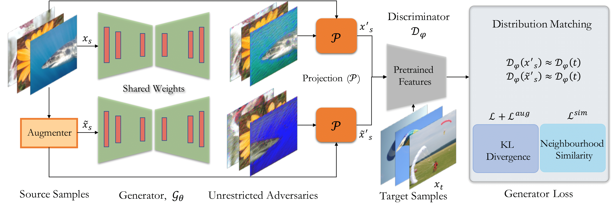 
</p>

## Target Transferability Vs Model Disparity
<sup>([top](#contents))</sup>
Our analysis indicates that there is a fundemental difference between Targeted and Untargeted transferability. Model disparity plays a critical role in how the targeted perturbations are transferred from one model to another. Here is an example (average transferability accross 10 targets):

<p align="center">
     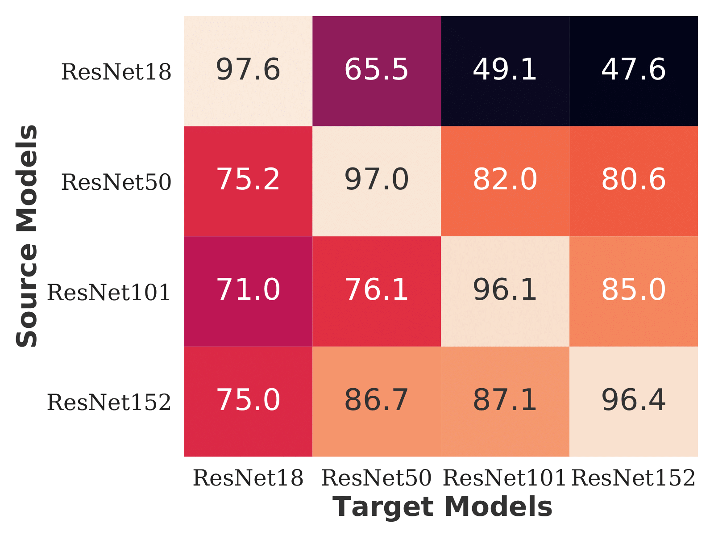 
</p>

- Observe that transferring targeted perturbations from a smaller model to a larger one (e.g., ResNet18 to ResNet152 is difficult as we increase the size discrepancy. This phenomenon holds true for untarget transferability.
- Targeted transferability trend remains the same even from larger to smaller models. For example, target transferability  from ResNet152 to ResNet50 is higher than from ResNet152 to ResNet18 even though ResNet18 is weaker than ResNet50. This is where targeted transferability differs from the untargeted case. 
- It is important to note that this behavior is common accross all targeted attacks (iterative or generative) which indicates that this property stems from disparity between the source and the target model. For example, depth between different ResNet models or skip connections between ResNet and DenseNet family reduce the targeted transferability. 
- We note that the dependence on disparity in model architectures can be mitigated with ensemble learning from the models of same family. Targeted transferability from ensemble of e.g., VGG models can be higher than any of the individual VGG model. This is important because an attacker can learn strong transferable targeted patterns from weak models.


## Pretrained Targeted Generator
<sup>([top](#contents))</sup> 
*If you find our pretrained Adversarial Generators useful, please consider [citing our work](#Citation).*

Class to Label Mapping

```
Class Number: Class Name
24: Great Grey Owl
99: Goose
245: French Bulldog
344: Hippopotamus
471: Cannon
555: Fire Engine
661: Model T
701: Parachute
802: Snowmobile
919: Street Sign       
```
### Targeted Adversarial Generators trained against Single ImageNet Model.
This is how the pretrianed generators are saved: _"netG_Discriminator_sourceDomain_epoch_targetDomain.pth" e.g., netG_vgg11_IN_19_24.pth means that generator is trained agisnt vgg11 (Discriminator) for 20 epoch by maximizing agreement between the source domain (natural images from ImageNet (IN)) and the target domain (images of Grey Owl)._ 
Source Models: VGG11, VGG13, VGG16, VGG19, VGG11_BN, VGG13_BN, VGG16_BN, VGG19_BN, ResNet18, ResNet50, ResNet101, ResNet152, Dense121, Dense161, Dense169, Dense201

### Targeted Adversarial Generators trained against Ensemble of ImageNet Model.
Source Ensemble: VGG{11,13,16,19}, Res{18,50,101,152}, Dense{121,161,169,201}


### Targeted Adversarial Generators trained against ResNet50.
We trained generators for 100 targets, but only for ResNet50. These generators are for the rest of the 90 targets distributed across ImageNet Classes.
Source Models: ResNet50 

These models can be downloaded from [here](https://drive.google.com/drive/folders/18ECJRvNMXeCh7oNXdl88RE7vuAFzwRmI?usp=drive_link)


## Training

1. _Source Domain dataset:_ You can start with paintings dataset such as described in [Cross Domain Attack](https://github.com/Muzammal-Naseer/Cross-domain-perturbations).
2. _Target Domain dataset:_ We obtain samples of a certain target domain (e.g. ImageNet class) from ImageNet training set.

Run the script with your target of choice:
```
 ./scripts/train.sh
```

## Evaluation
1. Download any or all of the pretrained generators to directory "pretrained_generators".
2. Download ImageNet models trained with [stylized ImageNet](https://github.com/rgeirhos/Stylized-ImageNet) and [augmentations](https://github.com/google-research/augmix) to directory "pretrained_models"
 
Run the following command to evaluate transferability of a target to (black-box) model on the ImageNet-Val.
```
  python eval.py  --data_dir data/IN/val --source_model res50 --source_domain IN --target 24 --eps 16 --target_model vgg19_bn 
```

### 10/100-Targets (all-source)
Perturb all samples of ImageNet validation (excluding the target class samples) to each of the 10/100 targets and observe the average target transferability to (black-box) model.

```
  python eval_all.py  --data_dir data/IN/val --source_model res50 --source_domain IN  --eps 16 --num_targets 100 --target_model vgg19_bn 
```

### 10-Targets (sub-source)
Select the samples of 10 target classes from ImageNet validation. Perturb the samples of these classes (excluding the target class samples) to each of 10 targets and observe the average target transferability to (black-box) model.

```
  python eval_sub.py  --data_dir data/IN/val --source_model res50 --source_domain IN --eps 16--target_model vgg19_bn 
```

##  Why Augmentations Boost Transferability?
<sup>([top](#contents))</sup>
_[Ilyas et al.](https://arxiv.org/abs/1905.02175)  showed that adversarial examples can be explained by features of the attacked class label. In our targeted attack case, we wish to imprint the features of the target class distribution onto the source samples within an allowed distance. However, black-box (unknown) model might apply different set of transformations (from one layer to another) to process such features and reduce the target transferability. Training on adversarial augmented samples allows the generator to capture such targeted features that are robust to transformations that may vary from one model to another._

##  Why Ensemble of Weak Models Maximizes Transferability?
<sup>([top](#contents))</sup>
_Different models of the same family of networks can exploit different information to make prediction. One such example is shown in here. Generators are trained against Dense121 and Dense169 to target Snowmobile distribution. Unrestricted generator outputs reveal that Dense121 is more focused on Snowmobile's blades while Dense169 emphasizes the background pine tree patterns to discriminate Snowmobile samples. This complementary information from different models of the same family helps the generator to capture more generic global patterns which transfer better than any of the individual models._

|Original Image|Source Model: Dense121, Target: Snowmobile|Source Model: Dense169, Target: Snowmobile|
|---|:---:|:---:|
|  | 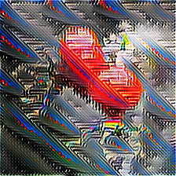| 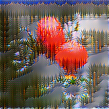 

##  Generative Vs Iterative Attacks

-  Image-specific (iterative) attacks run iterative optimization for each given sample. This optimization is expensive as it has to be repeated for each sample independently. On the other hand, a generator requires training but can adapt to input sample with a farward pass only.
- Targeted global perturbations are more transferable as indicated by our results. Iteratively optimizing for a target using a single image inherently lacks the ability to model global perturbations. This is where generative methods excel as they can model such perturbations during training phase.

### Key Developments made by Iterative Attacks
* [PGD](https://arxiv.org/abs/1706.06083) attack has lower transferability due to overfitting (ICRL-2018).
* [MI](https://arxiv.org/abs/1710.06081) intorduced momentum. It accumulates gradients over iterations to reduce overfitting (CVPR-2018).
* [DIM](https://arxiv.org/abs/1803.06978) introduced input transformations like padding or rescaling to diversify patterns. Think of it as a regulation in the input space to reduce overfitting (CVPR-2019).
* [Po-TRIP](https://openaccess.thecvf.com/content_CVPR_2020/papers/Li_Towards_Transferable_Targeted_Attack_CVPR_2020_paper.pdf) introduced triplet loss to push adversarial examples towards the target label while increasing their distance from the original label (CVPR 2020).
* [FDA-fd](https://arxiv.org/abs/2004.12519) introduced a method to model class-wise distribution within feature space across differnt layers of a network. Then transfer targeted perturbations from the single optimal layer (ICLR 2020).
* [FDA-N](https://arxiv.org/abs/2004.14861) adapts the FDA-fd across multiple layers and the classifier as well (NeurIPS 2020).
* [SGM](https://arxiv.org/abs/2002.05990) found that while back-propagating, giving more weightage to gradients from skip connections increases transferability (ICLR 2020).
* [LinBP](https://arxiv.org/abs/2012.03528) found that linear back-propagation can boost transferability (NeurIPS 2020).

### Key Developments made by Generative Attacks
* [GAP](https://arxiv.org/abs/1712.02328) introduced a mechanism to train generative networks against pretrained-models via cross-entropy (CVPR 2018).
* [CDA](https://arxiv.org/abs/1905.11736) introduced a mechanism to train generative network against pretrained-model via relativistic cross-entropy (NeurIPS 2019).
* [TTP](#Citation) introudced generative training to match a source and target domain within latent space of a pretrained-model based on gloabl distribution matching objectives. It does not rely on data annotations (labels) or classification boundary information (ICCV 2021).

<!--
## Tracking SOTA Targeted Transferability
<sup>([top](#contents))</sup>
Results on 10-Targets (sub-source) settings. 
* Select 500 samples belonging to 10 targets {24,99,245,344,471,555,661,701,802,919} from ImageNet validation set.
* Remove the samples of the target class. You are left with 450 samples.
* Run target attack to map these 450 samples to selected target (perturbation budget l_inf=16).
* Repeat this process for all the 10 targets.
* Report average target accuracy.

```
Updating....Meanwhile, please have a look at our paper. 
```
#### Unknown Target Model
<sup>([top](#contents))</sup>
_Attacker  has  access  to  a  pretrained  discriminator  trained  on labeled data but has no knowledge about the architecture of the  target  model._
|Method| Attack type | Source Model| Target Model| Distance |24|99|245|344|471|555|661|701|802|919|Average|
|---|:---:|:---:|:---:|:---:|:---:|:---:|:---:|:---:|:---:|:---:|:---:|:---:|:---:|:---:|:---:|
[PGD](https://arxiv.org/abs/1706.06083)| Iterative | ResNet50|Dense121|16|
[MI](https://arxiv.org/abs/1710.06081)| Iterative | ResNet50|Dense121|16|
[DIM](https://arxiv.org/abs/1803.06978)| Iterative | ResNet50|Dense121|16|
[Po-TRIP](https://openaccess.thecvf.com/content_CVPR_2020/papers/Li_Towards_Transferable_Targeted_Attack_CVPR_2020_paper.pdf) |Iterative | ResNet50|Dense121|16|
[FDA-fd](https://arxiv.org/abs/2004.12519)|Iterative | ResNet50|Dense121|16|
[FDA-N](https://arxiv.org/abs/2004.14861) |Iterative | ResNet50|Dense121|16|
[SGM](https://arxiv.org/abs/2002.05990)| Iterative | ResNet50|Dense121|16|
[SGM+LinBP](https://arxiv.org/abs/2012.03528)| Iterative | ResNet50|Dense121|16|
[GAP](https://arxiv.org/abs/1712.02328)|Generative|ResNet50|Dense121|16|
[CDA](https://arxiv.org/abs/1905.11736)|Generative|ResNet50|Dense121|16|
[TTP](#Citation)|Generative|ResNet50|Dense121|16|
[PGD](https://arxiv.org/abs/1706.06083)| Iterative | ResNet50|Dense121|16|
[MI](https://arxiv.org/abs/1710.06081)| Iterative | ResNet50|VGG19_BN|16|
[DIM](https://arxiv.org/abs/1803.06978)| Iterative | ResNet50|VGG19_BN|16|
[SGM](https://arxiv.org/abs/2002.05990)| Iterative | ResNet50|VGG19_BN|16|
[SGM+LinBP](https://arxiv.org/abs/2012.03528)| Iterative | ResNet50|VGG19_BN|16|
[GAP](https://arxiv.org/abs/1712.02328)|Generative|ResNet50|VGG19_BN|16|
[CDA](https://arxiv.org/abs/1905.11736)|Generative|ResNet50|VGG19_BN|16|
[TTP](#Citation)|Generative|ResNet50|VGG19_BN|16|

#### Unknown Training Mechanism
<sup>([top](#contents))</sup>
_Attacker  has  knowledge about the architecture of the  target  model but unaware of its training mechanism._
|Method| Attack type | Source Model| Target Model| Distance |24|99|245|344|471|555|661|701|802|919|Average|
|---|:---:|:---:|:---:|:---:|:---:|:---:|:---:|:---:|:---:|:---:|:---:|:---:|:---:|:---:|:---:|
[PGD](https://arxiv.org/abs/1706.06083)| Iterative | ResNet50|SIN|16|
[MI](https://arxiv.org/abs/1710.06081)| Iterative | ResNet50|SIN|16|
[DIM](https://arxiv.org/abs/1803.06978)| Iterative | ResNet50|SIN|16|
[Po-TRIP](https://openaccess.thecvf.com/content_CVPR_2020/papers/Li_Towards_Transferable_Targeted_Attack_CVPR_2020_paper.pdf) |Iterative | ResNet50|SIN|16|
[FDA-fd](https://arxiv.org/abs/2004.12519)|Iterative | ResNet50|SIN|16|
[FDA-N](https://arxiv.org/abs/2004.14861) |Iterative | ResNet50|SIN|16|
[SGM](https://arxiv.org/abs/2002.05990)| Iterative | ResNet50|SIN|16|
[SGM+LinBP](https://arxiv.org/abs/2012.03528)| Iterative | ResNet50|SIN|16|
[GAP](https://arxiv.org/abs/1712.02328)|Generative|ResNet50|SIN|16|
[CDA](https://arxiv.org/abs/1905.11736)|Generative|ResNet50|SIN|16|
[TTP](#Citation)|Generative|ResNet50|SIN|16|
[MI](https://arxiv.org/abs/1710.06081)| Iterative | ResNet50|Augmix|16|
[DIM](https://arxiv.org/abs/1803.06978)| Iterative | ResNet50|Augmix|16|
[Po-TRIP](https://openaccess.thecvf.com/content_CVPR_2020/papers/Li_Towards_Transferable_Targeted_Attack_CVPR_2020_paper.pdf) |Iterative | ResNet50|Augmix|16|
[FDA-fd](https://arxiv.org/abs/2004.12519)|Iterative | ResNet50|Augmix|16|
[FDA-N](https://arxiv.org/abs/2004.14861) | Iterative | ResNet50|Augmix|16|
[SGM](https://arxiv.org/abs/2002.05990)| Iterative | ResNet50|Augmix|16|
[SGM+LinBP](https://arxiv.org/abs/2012.03528)| Iterative | ResNet50|Augmix|16|
[GAP](https://arxiv.org/abs/1712.02328)|Generative|ResNet50|Augmix|16|
[CDA](https://arxiv.org/abs/1905.11736)|Generative|ResNet50|Augmix|16|
[TTP](#Citation)|Generative|ResNet50|Augmix|16|
[PGD](https://arxiv.org/abs/1706.06083)| Iterative | ResNet50|ADV|16|
[MI](https://arxiv.org/abs/1710.06081)| Iterative | ResNet50|ADV|16|
[DIM](https://arxiv.org/abs/1803.06978)| Iterative | ResNet50|ADV|16|
[Po-TRIP](https://openaccess.thecvf.com/content_CVPR_2020/papers/Li_Towards_Transferable_Targeted_Attack_CVPR_2020_paper.pdf) |Iterative | ResNet50|ADV|16|
[FDA-fd](https://arxiv.org/abs/2004.12519)|Iterative | ResNet50|ADV|16|
[FDA-N](https://arxiv.org/abs/2004.14861) |Iterative | ResNet50|ADV|16|
[SGM](https://arxiv.org/abs/2002.05990)| Iterative | ResNet50|ADV|16|
[SGM+LinBP](https://arxiv.org/abs/2012.03528)| Iterative | ResNet50|ADV|16|
[GAP](https://arxiv.org/abs/1712.02328)|Generative|ResNet50|ADV|16|
[CDA](https://arxiv.org/abs/1905.11736)|Generative|ResNet50|ADV|16|
[TTP](#Citation)|Generative|ResNet50|ADV|16|

#### Unknown Input Processing
<sup>([top](#contents))</sup>
_Attacker  has  knowledge about the architecture of the  target  model but unaware of the input processing defense._
|Method| Attack type | Source Model| Input Processing| Distance |24|99|245|344|471|555|661|701|802|919|Average|
|---|:---:|:---:|:---:|:---:|:---:|:---:|:---:|:---:|:---:|:---:|:---:|:---:|:---:|:---:|:---:|
[PGD](https://arxiv.org/abs/1706.06083)| Iterative|ResNet50|NRP|16|
[MI](https://arxiv.org/abs/1710.06081)| Iterative | ResNet50|NRP|16|
[DIM](https://arxiv.org/abs/1803.06978)| Iterative | ResNet50|NRP|16|
[Po-TRIP](https://openaccess.thecvf.com/content_CVPR_2020/papers/Li_Towards_Transferable_Targeted_Attack_CVPR_2020_paper.pdf) |Iterative | ResNet50|NRP|16|
[FDA-fd](https://arxiv.org/abs/2004.12519)|Iterative|ResNet50|NRP|16|
[FDA-N](https://arxiv.org/abs/2004.14861) |Iterative|ResNet50|NRP|16|
[SGM](https://arxiv.org/abs/2002.05990)| Iterative | ResNet50|NRP|16|
[SGM+LinBP](https://arxiv.org/abs/2012.03528)| Iterative | ResNet50|NRP|16|
[GAP](https://arxiv.org/abs/1712.02328)|Generative|ResNet50|NRP|16|
[CDA](https://arxiv.org/abs/1905.11736)|Generative|ResNet50|NRP|16|
[TTP](#Citation)|Generative|ResNet50|NRP|16|


##  What Can You Do? 

```
We will highlight future research directions here.
```
-->
##  References
<sup>([top](#contents))</sup>
Code depends on [BasicSR](https://github.com/xinntao/BasicSR). We thank them for their wonderful code base. 

##  Visual Examples
<sup>([top](#contents))</sup>
Here are some of the unrestricted targeted patterns found by our method (TTP). This is just for visualization purposes. It is important to note that during inference, these adversaries are projected within a valid distance (e.g l_inf<=16).


|Source Model: ResNet50, &nbsp; &nbsp; &nbsp; &nbsp; Target: Jellyfish|
|---|
|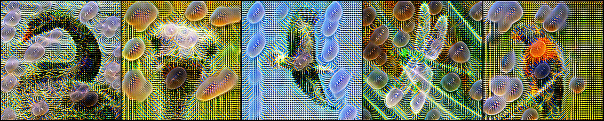|

|Source Model: ResNet50,  &nbsp; &nbsp; &nbsp; &nbsp; Target: Lipstick|
|---|
|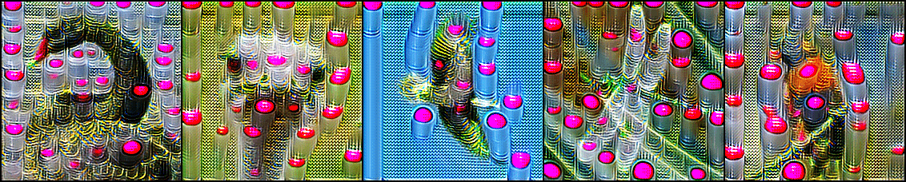|

|Source Model: ResNet50,  &nbsp; &nbsp; &nbsp; &nbsp; Target: Stove|
|---|
|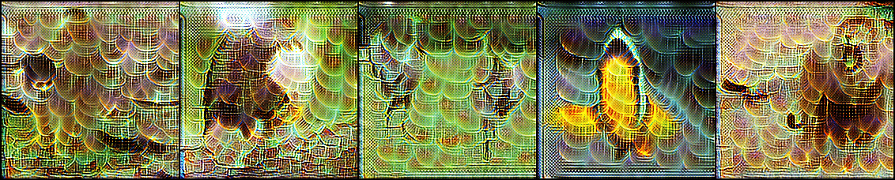|

|Source Model: ResNet50,  &nbsp; &nbsp; &nbsp; &nbsp; Target: Rapeseed|
|---|
|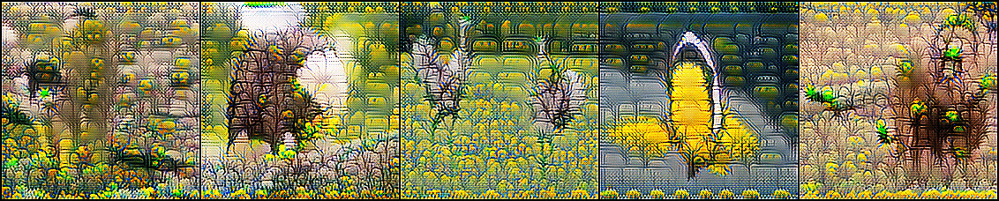|

|Source Model: ResNet50,  &nbsp; &nbsp; &nbsp; &nbsp; Target: Anemone Fish|
|---|
|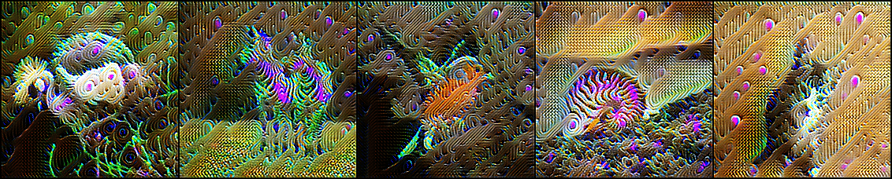|

|Source Model: ResNet50,  &nbsp; &nbsp; &nbsp; &nbsp; Target: Banjo|
|---|
|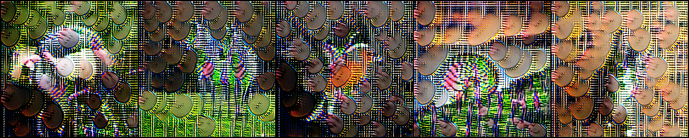|

|Source Model: ResNet50,  &nbsp; &nbsp; &nbsp; &nbsp; Target: Sea Urchin|
|---|
|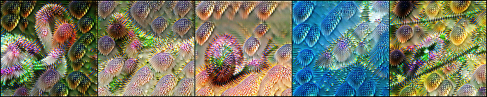|

|Source Model: ResNet50,  &nbsp; &nbsp; &nbsp; &nbsp; Target: Parachute|
|---|
|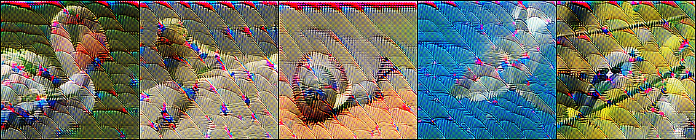|

|Source Model: ResNet50,  &nbsp; &nbsp; &nbsp; &nbsp; Target: Buckle|
|---|
|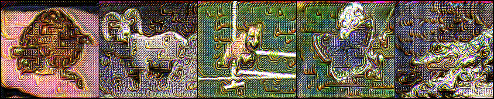|

|Source Model: ResNet50,  &nbsp; &nbsp; &nbsp; &nbsp; Target: iPOD|
|---|
|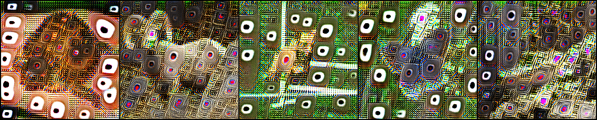|

|Source Model: ResNet50,  &nbsp; &nbsp; &nbsp; &nbsp; Target: Bookcase|
|---|
|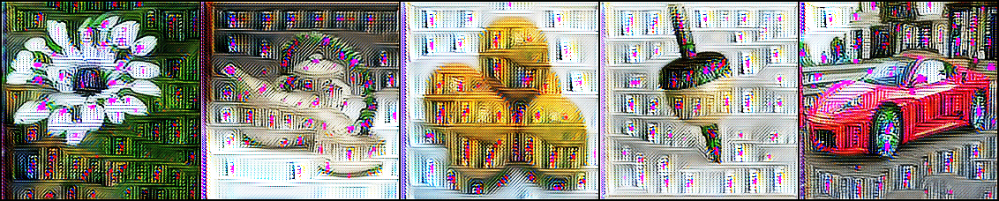|

|Source Model: ResNet50,  &nbsp; &nbsp; &nbsp; &nbsp; Target: Sewing Machine|
|---|
|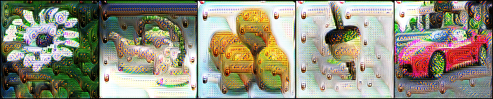|
